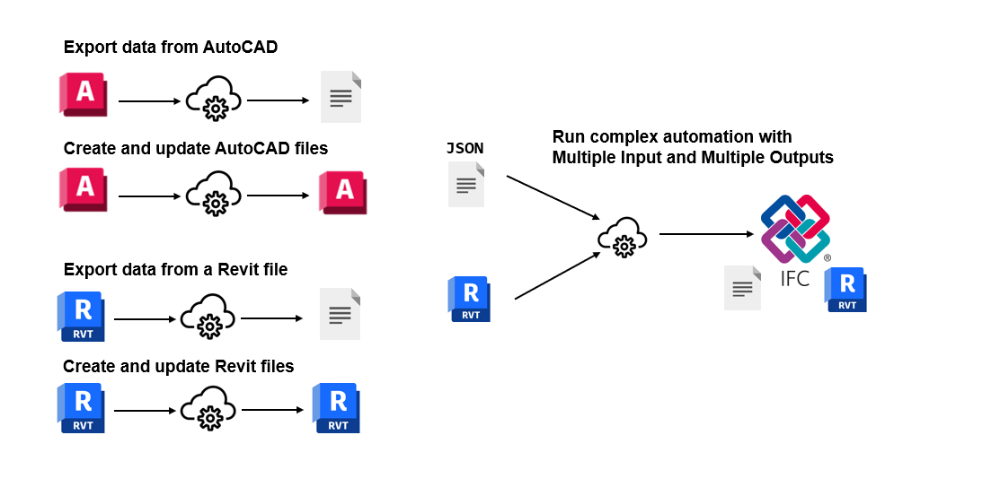

# APS Automation SDK



[](https://pypi.org/project/aps-automation-sdk/)

A Python SDK that wraps the Autodesk Platform Services (APS) [Design Automation API](https://aps.autodesk.com/en/docs/design-automation/v3/developers_guide/overview/), making it faster and easier to automate Revit and AutoCAD workflows in the cloud. 

## Installation

Get started in seconds with pip:


```bash
pip install aps-automation-sdk
```

## Capabilities

Currently, the SDK supports **AutoCAD** and **Revit**.

- **Export data from AutoCAD**: Extract information from DWG files and save to various formats
- **Create and update AutoCAD files**: Modify DWG files programmatically in the cloud
- **Export data from Revit files**: Extract data from RVT files (IFC, schedules, parameters, etc.)
- **Create and update Revit files**: Modify RVT files (add/delete elements, change parameters, etc.)
- **Run complex automation**: Execute workflows with multiple inputs and outputs, combining JSON configurations with CAD/BIM files
- **Sign public activities for ACC workflows**: Use built in helpers to generate keys, upload public key, sign activity IDs, and submit signed public workitems
- **Mint SSA based 3lo tokens**: Use SSA helpers to authenticate ACC and Design Automation flows with robot users

## Start Right Away

Test the SDK with our ready-to-use examples in the [`examples`](examples/) folder:

- **AutoCAD_01_list_layers**: Extract layer names from a DWG file
- **Revit_01_delete_walls**: Remove walls from a Revit model
- **Revit_02_export_to_ifc**: Export IFC files from Revit with custom settings
- **Revit_03_create_structural_elements**: Create structural beam elements from JSON configuration
- **Revit_04_change_global_params**: Modify global parameters in Revit models
- **Common_05_workitem_signing**: Generate signing keys, upload public key, and sign a Design Automation activity
- **Common_06_workitem_signing_cli**: Run the same signing flow with the `aps-automation` CLI commands
- **Common_07_ssa_create_and_token**: Set up SSA inputs and mint a 3lo token for ACC and Design Automation flows

Each example includes a Jupyter notebook with step-by-step instructions and sample files.

**Before running the examples**, create a `.env` file in the project root with your APS credentials:

```ini
CLIENT_ID=your_client_id_here
CLIENT_SECRET=your_client_secret_here
```

You can use `.env.sample` as a reference. To get your credentials, create an Autodesk Platform Services application at: https://get-started.aps.autodesk.com/

## Poll workitem progress

Use `on_event` to receive a `WorkItemPollEvent` after each status request.
The event includes `approximate_queue_position: int | None`.
It contains a positive integer while the workitem is pending, if APS supplies a position.
It is `None` when the value is absent, null, or invalid, or when the workitem is no longer pending.

With an existing `work_item` and token:

```python
from aps_automation_sdk import WorkItemPollEvent


def show_progress(event: WorkItemPollEvent) -> None:
    if event.status == "pending":
        message = "Waiting in APS queue."
        if event.approximate_queue_position is not None:
            message += f" Position: approximately {event.approximate_queue_position}."
    elif event.status == "inprogress":
        message = "Revit model generation is running."
    else:
        message = f"APS job status: {event.status}."
    print(f"{message} Elapsed: {event.elapsed_seconds} s.")


work_item_id = work_item.run(token)
result = work_item.poll(
    work_item_id=work_item_id,
    token=token,
    interval=5,
    max_wait=600,
    on_event=show_progress,
)
```

In a VIKTOR app, send the message with `vkt.progress_message(message=...)`.
The SDK does not require VIKTOR.

APS marks queue position as Beta. Position can increase or decrease between requests.
It does not provide an estimated wait time or a completion percentage.
See the [APS status reference](https://aps.autodesk.com/en/docs/design-automation/v3/reference/http/workitems-id-GET/)
and the [10 August 2026 change](https://aps.autodesk.com/en/docs/design-automation/v3/change_history/changelog_v3/).

Existing event constructors and callbacks can omit the new field. Its default is `None`.
Code that serializes the complete event must accept one additional field.
The raw status dictionary returned by `poll()` is unchanged.

## For Agents
This repository provides agent context files for developers:

- `AGENTS.md`
- `CLAUDE.md`
- `llms-full.txt`

This repository also publishes the following skills:

- `.agents/skills/aps-acc-public-activity-signing/`
- `.agents/skills/full-llm-export/`

Use this skill to run APS public activity signing workflows end-to-end:
- generate RSA keys
- export and upload public key to `forgeapps/me`
- sign activity IDs
- connect signatures to ACC/public workitem execution flows

### For Codex
Codex reads project skills from `.agents/skills/`.

Install this skill into your local repo:

```bash
npx skills add https://github.com/viktor-platform/aps-automation-sdk \
  --skill aps-acc-public-activity-signing \
  --copy \
  -a codex \
  -y
```

This copies the skill into: `.agents/skills/`

### For Claude Code
Install this skill for Claude Code:

```bash
npx skills add https://github.com/viktor-platform/aps-automation-sdk \
  --skill aps-acc-public-activity-signing \
  --copy \
  -a claude-code \
  -y
```

This copies the skill into: `.claude/skills`

## Contribute
For contributing and local installation instructions, see [CONTRIBUTING.md](CONTRIBUTING.md).
